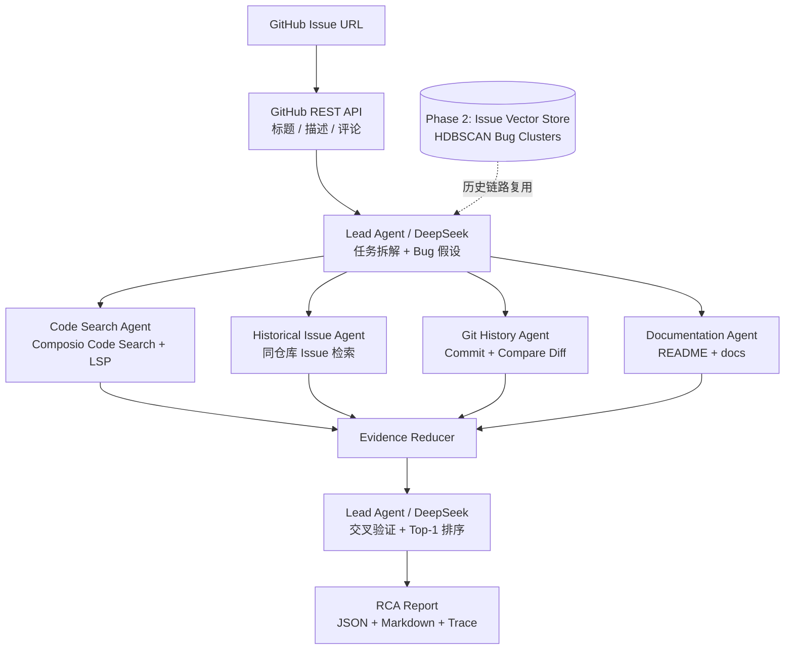
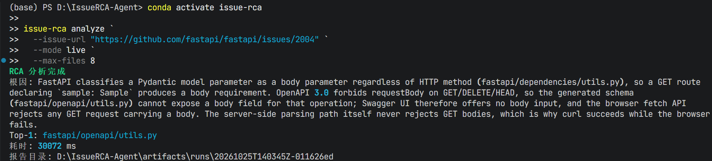

# IssueRCA-Agent

面向 GitHub Issue 的多 Agent 根因诊断与代码定位系统。输入一个 Issue URL，系统自动拉取 Issue 上下文，由 Lead Agent 生成 Bug 假设，并行调度代码检索、历史 Issue、Git 提交和项目文档四类 Sub-Agent，最终输出结构化 RCA 报告与 Top-1 可疑代码位置。

> 当前状态：**Phase 1 CLI MVP**。已包含可运行 Mock Demo、真实 GitHub/DeepSeek/Composio 接口和自动化测试；RAG、HDBSCAN 与 SWE-Bench 500 case 评测将在后续阶段完成。

## 项目价值

传统 Issue 排查需要工程师在源码、历史 Issue、提交记录和文档之间反复切换。IssueRCA-Agent 将这些检索任务拆成并行 Agent，并保留每条结论的证据来源，目标是：

- 缩短从 Issue 创建到形成初步根因判断的时间；
- 输出可验证的代码文件、符号和行范围，而不是泛化建议；
- 复用历史故障模式，为 CI/CD 故障排查和仓库维护提供统一入口；
- 在 SWE-Bench Verified 上形成可复现、可量化的代码定位评测。

## 架构



### 请求流

1. `GitHubClient` 通过 GitHub REST API 获取 Issue、评论和默认分支。
2. Lead Agent 第一次调用 DeepSeek，生成 `InvestigationPlan` 与 2-4 个可验证假设。
3. LangGraph 在同一 superstep 并行运行 4 个 Sub-Agent。
4. 每个 Sub-Agent 先获取原始证据，再使用角色专属 Prompt 生成 `AgentEvidence`。
5. Reducer 合并证据；单 Agent 失败不会覆盖其他结果。
6. Lead Agent 第二次汇总，输出 `RCAReport` 和 Top-1 代码位置。
7. 运行结果写入 `artifacts/runs/<run-id>/`。

## 当前功能

- [x] LangGraph Lead + 4 Sub-Agent 并行图
- [x] GitHub Issue、评论和仓库信息获取
- [x] Composio Sessions GitHub 原生只读工具
- [x] DeepSeek OpenAI-compatible API
- [x] Mock / Live 双模式
- [x] DeepSeek Responses API JSON Schema Structured Outputs、Pydantic 校验与有限重试
- [x] Markdown、JSON、Trace 三类运行产物
- [x] Token、工具调用、节点耗时和错误统计
- [x] 可选 `multilspy` 本地 LSP 接口
- [ ] 历史 Issue 向量库与 HDBSCAN 聚类
- [ ] SWE-Bench Verified 500 case 完整评测

## 快速开始

### 1. 创建 Python 环境

项目推荐 Python 3.11。本机 Windows + Conda 示例：

```powershell
conda env create -f environment.yml
conda activate issue-rca
python -m pip install --upgrade pip
pip install -e ".[dev,lsp,rag]"
```

如果暂时只运行 Phase 1，可减少本地模型依赖：

```powershell
pip install -e ".[dev]"
```

### 2. 配置密钥

```powershell
Copy-Item .env.example .env
```

编辑 `.env`：

```dotenv
ISSUE_RCA_MODE=live
DEEPSEEK_API_KEY=your_deepseek_key
MAX_AGENT_OUTPUT_TOKENS=1200
DEEPSEEK_SYNTHESIS_MAX_TOKENS=1800
GITHUB_TOKEN=your_readonly_github_token
COMPOSIO_API_KEY=your_composio_key
COMPOSIO_USER_ID=issue-rca-local
COMPOSIO_GITHUB_CONNECTED_ACCOUNT_ID=ca_optional_account_id
```

注意：

- `.env` 已加入 `.gitignore`，不要提交真实密钥。
- GitHub Fine-grained Token 只需目标仓库的 Contents、Issues、Pull requests 读取权限。
- Composio 项目 Key 需要 Session management 与原生 Tool execution 权限。
- Composio 用户需先在 **Composio Platform 项目**中为 `COMPOSIO_USER_ID` 连接 GitHub；项目自己的 `GITHUB_TOKEN` 不会自动成为 Composio connected account。
- 如该用户只有一个 ACTIVE GitHub connection，可不填 connected account ID；否则设置 `COMPOSIO_GITHUB_CONNECTED_ACCOUNT_ID` 固定目标账号。

### 3. 连接 Composio GitHub 账号

`GITHUB_TOKEN` 只供 IssueRCA-Agent 自己的 GitHub REST Client 使用，不会自动成为 Composio connected account。首次使用 Live 模式前运行：

```powershell
issue-rca composio connect github
```

命令会：

1. 使用当前 `COMPOSIO_USER_ID` 创建受限 Session；
2. 调用 `session.authorize("github")`；
3. 在终端打印 GitHub Connect Link；
4. 默认等待最多 180 秒；
5. 只有当连接状态为 `ACTIVE`、toolkit 为 `github`、user ID 匹配，且原生只读工具验证成功后，才报告授权成功。

如果不希望命令阻塞等待：

```powershell
issue-rca composio connect github --no-wait
```

完成浏览器授权后检查：

```powershell
issue-rca composio status github
```

如果希望成功后仅把 connected account ID 写入 `.env`：

```powershell
issue-rca composio connect github --save-id
```

该选项只更新 `COMPOSIO_GITHUB_CONNECTED_ACCOUNT_ID`，不会保存 OAuth Token，也不会修改其他配置。

### 4. 环境诊断

`doctor` 会执行一次最小 DeepSeek 请求，因此会产生极少量 token：

```powershell
issue-rca doctor
```

### 5. 运行零成本 Mock Demo

```powershell
issue-rca demo
```

也可以通过统一入口运行：

```powershell
issue-rca analyze `
  --issue-url https://github.com/example/checkout-service/issues/42 `
  --mode mock
```

### 6. 分析真实 Issue

```powershell
issue-rca analyze `
  --issue-url https://github.com/OWNER/REPO/issues/123 `
  --mode live `
  --max-files 8
```

## 输出

每次运行生成：

```text
artifacts/runs/
├── <run-id>/
│   ├── report.md       # 面向人阅读的 RCA 报告
│   ├── report.json     # 结构化结果，可直接用于评测
│   └── trace.json      # InvestigationPlan、AgentEvidence 和运行指标
└── _llm_diagnostics/  # 仅在结构化输出失败时保存脱敏诊断
```

`RCAReport` 包含：

- Issue 摘要与复现线索；
- Top-1 根因与置信度；
- 排序后的文件、符号和行范围；
- 支持证据、反向证据和被排除假设；
- 推荐验证步骤与不确定性；
- 总耗时、节点耗时、工具调用和 token 使用量。

## Demo 截图

运行 `issue-rca demo` 后，将终端截图放到 `docs/images/demo.png`，再取消下面这一行的注释：

```markdown
<!--  -->
```

## 安全设计

- Composio Session 仅启用 GitHub toolkit。
- 禁用 `createHint`、`updateHint`、`destructiveHint` 类工具。
- 关闭 Composio Sandbox、Sandbox Proxy 和 Session Proxy，避免模型自由执行 shell 或任意 HTTP 请求。
- 应用层仅允许 8 个显式列出的 GitHub 原生只读工具，不启用 Proxy Execute。
- 模型不接触 GitHub 或 Composio 凭据。
- 报告和 trace 不记录 Authorization Header、API Key 或 Token。
- 单 Agent 异常以 degraded/error 证据记录，不会被隐藏。

## 成本控制

- 调试优先使用 `issue-rca demo`，不调用任何外部 API。
- 真实分析默认只读取前 10 个候选文件，并截断长文件和 diff。
- Lead Agent 2 次调用，4 个 Sub-Agent 各 1 次调用。
- `MAX_AGENT_OUTPUT_TOKENS` 控制规划和 Sub-Agent 输出，默认 1200。
- `DEEPSEEK_SYNTHESIS_MAX_TOKENS` 只控制最终 RCA 汇总，默认 1800；最终输入会先去重并移除原始工具预览。
- 结构化生成显式关闭 reasoning，避免思考 token 挤占 JSON 输出。
- 输出不完整或 Schema 校验失败时最多重试一次，失败响应会脱敏保存到 `artifacts/runs/_llm_diagnostics/`。
- 每次运行记录 prompt/completion tokens，方便后续计算单 case 成本。

## 测试

```powershell
pytest
ruff check .
```

测试覆盖：

- GitHub Issue URL 解析和 API 响应转换；
- 4 个 Sub-Agent 的并行聚合；
- 单 Agent 失败降级；
- DeepSeek 非法 JSON 的一次修复重试；
- 报告 JSON/Markdown 一致性；
- Composio 原生只读工具白名单与 Proxy 禁用配置；
- 输出中不泄露 Secret。

## Phase 2：RAG + HDBSCAN

计划流程：

1. 拉取仓库历史 Issue 标题、正文、评论、标签和最终修复 PR。
2. 使用 `sentence-transformers` 生成向量。
3. 保存向量、Issue 元数据和历史 RCA 链路。
4. 使用 HDBSCAN 聚类，形成空指针、状态同步、版本兼容、配置错误等 Bug 模式簇。
5. 新 Issue 优先召回相似历史案例，将历史假设和有效检索路径注入 Lead Agent。
6. 对比关闭/开启历史复用时的分析耗时和定位准确率。

## Phase 3：SWE-Bench Verified 评测

SWE-Bench Verified 包含 500 个经过人工确认可解决的真实软件工程任务。

### 指标定义

**Top-1 代码定位命中率**

系统排名第一的文件路径出现在该 case 的 gold patch 修改文件集合中即视为命中：

```text
Top-1 Hit Rate = 命中 case 数 / 有效 case 总数
```

**端到端耗时下降比例**

```text
(baseline_median_latency - rag_median_latency)
------------------------------------------------ × 100%
             baseline_median_latency
```

Baseline 与 RAG 版本必须使用相同 case、模型参数、并发度和机器配置。

### 评测结果模板

| 数据集 | Case 数 | 模式 | Top-1 命中率 | Median 耗时 | P95 耗时 | 平均 Token/Case |
|---|---:|---|---:|---:|---:|---:|
| SWE-Bench Verified | 10 | Smoke Test | TBD | TBD | TBD | TBD |
| SWE-Bench Verified | 500 | Baseline | TBD | TBD | TBD | TBD |
| SWE-Bench Verified | 500 | RAG + HDBSCAN | TBD | TBD | TBD | TBD |

> 禁止在真实评测前把 `TBD` 替换成估计值。

## 简历描述模板

完成真实评测后再填写数字：

> 设计并实现 IssueRCA-Agent，一套面向 GitHub Issue 的自动根因诊断系统；基于 LangGraph 构建 Lead Agent 与 4 类并行 Sub-Agent，分别检索源码、历史 Issue、Git 提交和项目文档，并通过证据聚合输出 Top-1 可疑代码位置；使用 HDBSCAN 对历史 Issue 进行 Bug 模式聚类，新 Issue 优先召回并复用历史分析链路，使端到端分析耗时降低 **XX%**；在 SWE-Bench Verified 500 case 上实现 **XX% Top-1 文件定位命中率**。

## 参考项目

- [OpenHands](https://github.com/All-Hands-AI/OpenHands)：CodeAct、工具调用和隔离运行环境参考
- [Composio](https://github.com/ComposioHQ/composio)：GitHub 工具、认证和 Session 权限控制
- [SWE-Bench](https://github.com/SWE-bench/SWE-bench)：真实 GitHub Issue 软件工程评测基准
- [OpenHands Benchmarks](https://github.com/OpenHands/benchmarks)：Agent benchmark harness 参考
- [CodeRabbit](https://www.coderabbit.ai/)：代码审查产品和多阶段分析流程参考
- [multilspy](https://github.com/microsoft/multilspy)：跨语言 LSP client

## 已知限制

- Phase 1 的 Git 历史 Agent 比较最近两次 commit，尚未根据 blame 或修复 PR 做精确时间窗筛选。
- 远程仓库默认使用 Composio Code Search；LSP 仅在配置 `LOCAL_REPO_PATH` 时启用。
- Phase 1 不自动执行仓库测试或生成修复 patch，只输出 RCA 和定位结果。
- GitHub Code Search 的可见范围取决于连接账号权限和 API 限流。

## License

MIT


